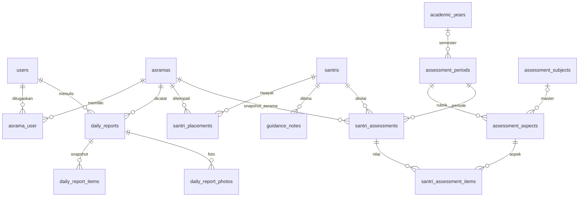

# Peta kode dan data

Diverifikasi dari source pada 24 November 2026. Baca [AI_GUIDE.md](AI_GUIDE.md) untuk aturan bisnis. Versi package terbaru harus dicek dari lock/Composer, bukan disimpulkan dari PRD awal.

## Aliran request

`routes/web.php` → auth + EnsureActive → komponen Livewire atau controller → service bisnis → policy/Gate + scope visibleTo → Eloquent/transaksi → Blade atau response PDF/Excel.

Route settings berada di `routes/settings.php`, autentikasi di Fortify/provider/actions. Tidak ada frontend React/Inertia pada modul bisnis. Nama class `MusyrifahDashboard` dan `ManageMusyrifah` juga melayani musyrif; jangan menyimpulkan class tersebut hanya untuk perempuan.

## Peta modul

| Area / route name | Komponen / controller utama | Service / policy |
|---|---|---|
| dashboard.admin, dashboard.koordinator, dashboard.musyrifah | Dashboard/AdminDashboard, KoordinatorDashboard, MusyrifahDashboard | ReportStatisticsService |
| reports.create, reports.edit | Reports/ReportForm | DailyReportService / DailyReportPolicy |
| reports.index, reports.monitoring | Reports/ReportHistory, ReportMonitoring (turunan History) | DailyReport::visibleTo |
| reports.show | Reports/ReportDetail | DailyReportService / DailyReportPolicy |
| reports.monthly, reports.export | Reports/MonthlyRecap, ReportExportController | ReportStatisticsService, XlsxExportService |
| reports.photos | Closure route foto privat | DailyReportPolicy + Storage local |
| admin.users | Admin/ManageMusyrifah | User, asrama_user, active admin checks |
| admin.asramas, admin.asrama-students | Admin/ManageAsrama, ManageAsramaStudents | AsramaStudentService, SantriService / SantriPolicy |
| admin.tasks | Admin/ManageTasks | DailyTask, active admin checks |
| santri.index, santri.show | Santri/SantriIndex, SantriDetail | SantriService / SantriPolicy |
| admin.academic-settings | Admin/AcademicSettings | AcademicYearService, AcademicPeriodService |
| admin.assessment-subjects | Admin/ManageRaporMasters | AssessmentSubject |
| santri.rapor | Assessments/RaporAsrama | AcademicPeriodService + scopes |
| santri.grades | Assessments/AspectGradeForm | AspectGradeService, SantriAssessmentService / SantriAssessmentPolicy |
| assessments.form | Assessments/AssessmentForm | SantriAssessmentService |
| assessments.index, assessments.show | Assessments/AssessmentMonitoring, AssessmentDetail | SantriAssessmentPolicy, SantriAssessmentService |
| assessments.print | SantriAssessmentPrintController | AssessmentPdfService / policy print |
| santri.print-asrama, santri.leger | AssessmentExportController | AssessmentPdfService, XlsxExportService |

Komponen ditulis relatif terhadap `app/Livewire`, controller terhadap `app/Http/Controllers`. Path/parameter persis ada di routes, gunakan named route. Route statis `/santri/rapor-asrama/...` harus tetap sebelum `/santri/{santri}`. Route lama `admin/assessment-periods` redirect ke Tahun Ajaran; bukan halaman pengelolaan global kedua.

`Admin/ManageAssessmentPeriods` masih digunakan untuk modal rubrik semester melalui komponen terpusat; keberadaannya tidak berarti admin harus membuat periode di dua tempat.

## Tanggung jawab service

- DailyReportService: validasi, penempatan saat laporan baru, snapshot item, status, foto privat dan audit.
- ReportStatisticsService: rekap harian/bulanan menurut cakupan dan riwayat penempatan; perubahan pagination tidak boleh membatasi datanya untuk ekspor/perhitungan.
- SantriService: identitas, perubahan penempatan, catatan, hapus identitas tanpa riwayat.
- AsramaStudentService: assign satu/banyak, validasi atomik pilihan, lock asrama lalu santri berurutan, keluarkan tanpa menghapus identitas.
- AcademicYearService: tahun + dua semester, aktivasi/nonaktif dan penghapusan yang dibatasi riwayat.
- AcademicPeriodService: periode aktif global dan penggantian aktivasi.
- AspectGradeService: konteks batch nilai asrama/aspek, baris yang berwenang, transaksi; tidak lagi memiliki batas 10 santri.
- SantriAssessmentService: snapshot rapor, validasi rating/skala, optimistic version, submit/review/reopen, audit.
- AssessmentPdfService: render Blade menjadi PDF privat A4, tanpa remote resource.
- XlsxExportService: berkas XLSX untuk ekspor bisnis; jangan mengubahnya menjadi ekspor halaman tabel saja.

## Peta database

Ini peta konsep dari migration, bukan dump data hosting. Baca seluruh migration berurutan untuk schema akhir: beberapa kolom ditambah/diubah setelah create awal.

| Tabel | Isi dan hubungan penting |
|---|---|
| users | Role, status, hashed password, kredensial, Fortify/passkeys/2FA |
| asramas | Nama, code unik, unit, gender, status |
| asrama_user | Riwayat user–asrama, assignment_role, start_date/end_date; bukan pivot yang bebas di-sync dengan menghapus histori |
| daily_tasks | Master kegiatan aktif, urutan, jadwal |
| daily_reports | FK user/asrama; unik user_id + report_date + asrama_id; status dan pemeriksa |
| daily_report_items | Snapshot judul/urutan tugas + completed; unik report + task |
| daily_report_photos | Metadata dan path privat foto; FK report |
| report_audits | Pelaku, action, JSON changes untuk laporan harian |
| santris | Nama, NISN nullable unik, gender nullable, status, birth_place/date, keluarga/kontak |
| santri_placements | Riwayat santri–asrama start/end; currentPlacement memakai tanggal hari ini |
| guidance_notes | FK santri/asrama/user, tanggal/kategori/content/follow_up |
| academic_years | Nama unik, status, tanggal awal/akhir |
| assessment_subjects | Master aspek dan indikator aktif |
| assessment_periods | Tahun nullable untuk legacy, semester, nama/tanggal/status, JSON rating_labels |
| assessment_aspects | Salinan aspek pada periode, FK subject nullable, judul/indikator/urutan |
| santri_assessments | Unik santri_id + assessment_period_id; asrama/user, snapshot identitas, catatan, status, reviewed/submitted, version |
| santri_assessment_items | Snapshot judul/indikator/urutan/skala, rating/notes; unik assessment + aspect |
| assessment_audits | FK assessment/user, action, JSON changes |

Tabel cache/jobs/session/auth pendukung mengikuti migration framework yang terpasang. `santri_placements` dan `asrama_user` merupakan dua konsep berbeda. Tanggal akhir penempatan dikelola supaya riwayat tetap ada; jangan mengganti dengan detach/drop data.

Batas tanggal, snapshot, uniqueness, version, policy dan transaksi sama pentingnya dengan relasi FK. Gender/logo kop PDF dan nama pembina saat cetak masih dibaca dari master relasi; jangan mendokumentasikannya sebagai snapshot penuh seluruh dokumen.

## Peta tes untuk perubahan

| Perubahan | Tes awal yang relevan di tests/Feature |
|---|---|
| Harian/status/foto | SimusTest, ReportMonitoringTest, ReportHistoryPaginationTest |
| Statistik/dashboard | DashboardPaginationTest, RemainingListPaginationTest, ReportMonitoringTest |
| Seeder/kredensial | SimusSeederTest, Auth/*, PembinaEditorTest |
| Asrama/pilihan banyak/kegiatan/pagination | AsramaStudentTest, RemainingListPaginationTest |
| Santri/keluarga/scope/catatan | SantriGuidanceTest, SantriDeletionTest |
| Tahun/semester global | AcademicYearFlowTest, GlobalAcademicPeriodTest |
| Nilai batch/snapshot/versi | AspectGradeFlowTest, SantriGuidanceTest |
| PDF/kop/logo/akses cetak | RaporPdfTest, AspectGradeFlowTest, SantriGuidanceTest; lanjut inspeksi PDF aktual |

Daftar tes adalah titik awal, bukan janji bahwa semua skenario hosting tercakup. Jalankan tes terkait setelah perubahan; jumlah tes dalam riwayat bukan bukti kondisi checkout baru.
